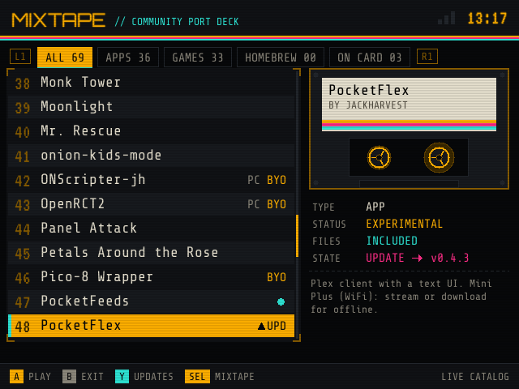
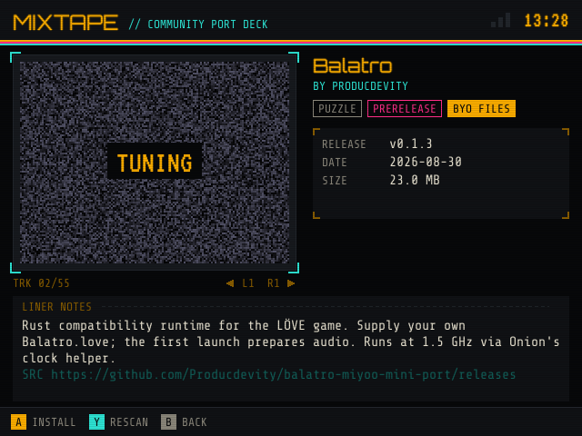
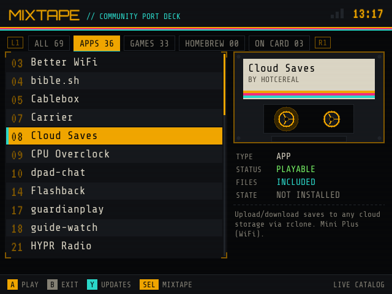
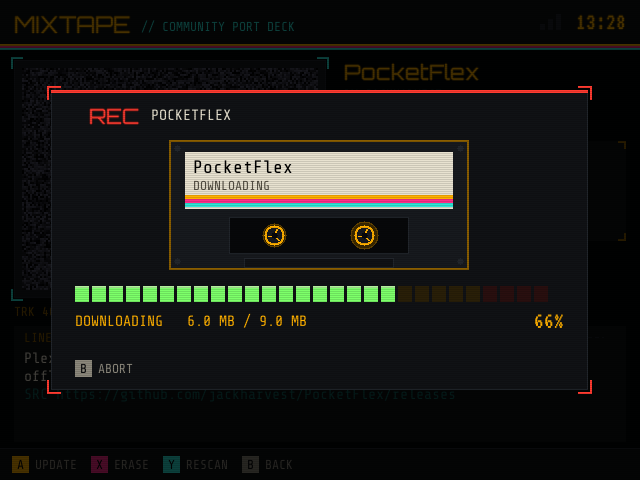
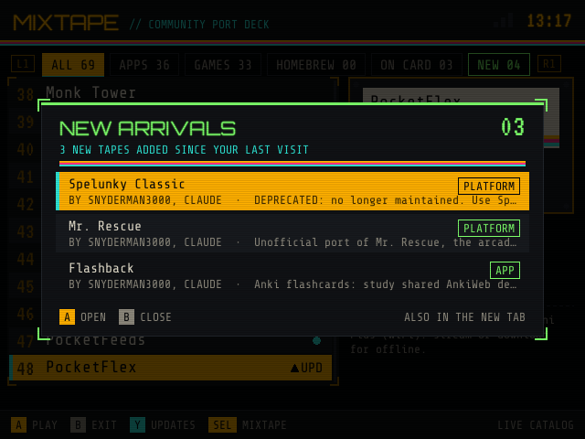
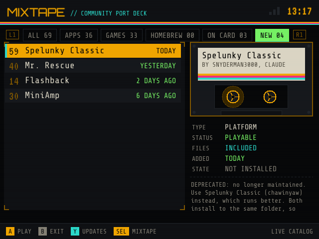
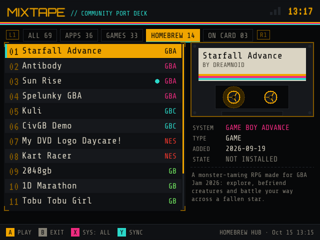
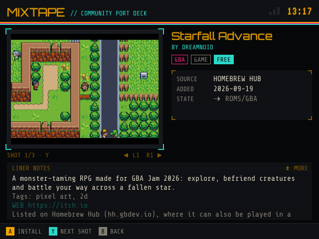
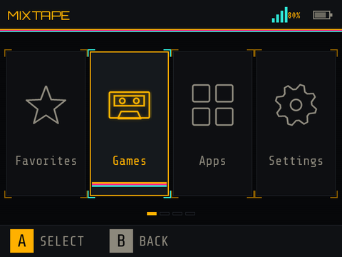

# MIXTAPE

**A community port deck for OnionOS on the Miyoo Mini Plus.** Browse the community-made apps and game ports for your handheld, plus over 1,600 homebrew games for the Game Boy, Game Boy Color, Game Boy Advance and NES, then install, update and remove them over Wi-Fi without taking the SD card out.

> 🤖 **Built by Claude.** Mixtape was designed and written by [Claude](https://claude.ai), Anthropic's AI model, at the request of [@snyderman3000](https://github.com/snyderman3000). He came up with the idea, chose the direction and tested it on real hardware. Claude wrote the code, the documentation and the artwork. Please report bugs through [Issues](https://github.com/snyderman3000/mixtape/issues).

| | |
|---|---|
|  |  |
|  |  |
|  |  |
|  |  |

## Features

- **The whole community catalog.** Mixtape reads the live [MiyooMini-Ports](https://github.com/Producdevity/MiyooMini-Ports) catalog maintained by Producdevity, so new ports appear without a Mixtape update. If you're offline it uses the last catalog it downloaded, or a copy built into the app. A few projects not in that catalog yet (such as [Panel Attack](https://github.com/snyderman3000/panelattack-miyoo)) are listed from Mixtape's own [`catalog/extra.json`](catalog/extra.json). If a project is in both, it's shown once, using the community catalog's entry with any install hints from `extra.json`.
- **Porters' own catalogs.** Porters who host their downloads on their own site can publish a small catalog file, and Mixtape lists their games next to everything else, with updates. The list lives in [`catalog/sources.json`](catalog/sources.json), so new catalogs appear without a Mixtape update. First on it: [Miyoo64](https://github.com/mr-finster/miyoo64) by mr-finster (nine native N64 ports). See [Publishing your own catalog](#publishing-your-own-catalog).
- **Homebrew from Homebrew Hub.** The **HOMEBREW** tab lists the Game Boy, Game Boy Color, Game Boy Advance and NES homebrew archived on [Homebrew Hub](https://hh.gbdev.io), the collection behind [gbdev.io](https://gbdev.io), [gbadev.org](https://gbadev.org) and [nesdev.org](https://www.nesdev.org). Newest additions are at the top, and X switches between systems. Installing saves the ROM straight into OnionOS's folder for that system (`Roms/GBA`, `Roms/GBC`, `Roms/GB` or `Roms/FC`), names it after the game and adds its cover as box art. The list is read live from Homebrew Hub's [public API](https://github.com/gbdev/homebrewhub/blob/main/API.md); nothing from it is built into Mixtape. The first visit downloads the whole list in the background (about a minute) and keeps a copy on the card; after that, Mixtape only asks for what's new. ROM hacks of commercial games aren't listed.
- **One-button installs.** It downloads each project's newest GitHub release, detects where the files belong (`App/`, `Roms/PORTS`, and so on) and installs them. Projects without releases are installed from their repository.
- **What's new.** When you open Mixtape and apps or ports have been added to the catalog since your last visit, a **NEW ARRIVALS** window lists them. Press A to open one, or B to close the window. They also stay in a **NEW** tab for 14 days, newest first. On the very first visit nothing is announced. Mixtape remembers what it has shown in `data/seen.json`.
- **Updates.** When you open Mixtape, it checks what it installed in the background. If anything has a new version, an **UPDATES READY** window lists it (each new version is announced once), and it's marked **▲UPD** in the list. Press Y to check again at any time. Updates keep settings files you've edited.
- **Updates itself.** Mixtape checks its own GitHub releases at startup and shows **▲ READY · SELECT** in the header when there's a new version. Press SELECT and choose **Update Mixtape**; your settings are kept and Mixtape restarts.
- **Mixtape in Games (optional).** In the SELECT menu, **Mixtape in Games list** adds Mixtape to OnionOS's Games list as its own system. From there you can add it to Favorites, so it's on the home screen instead of deep in Apps. It's off until you turn it on, and turning it off removes everything it added (`Emu/MIXTAPE` and `Roms/MIXTAPE`).
- **A matching OnionOS theme.** `Mixtape-Theme-vX.Y.Z.zip` in each release reskins OnionOS in the same amber-phosphor style: main menu, lists, dialogs, toggles, the boot and power screens and a tape-reel charging animation. See [OnionOS theme](#onionos-theme).
- **Clean removal.** Erase deletes only the files Mixtape recorded when installing, and refreshes the Ports list for you. If the app ships a cleanup script (see below), Erase runs it first.
- **Safe by design.** Nothing is written outside the SD card, and Onion's own system files are never replaced.
- **Bring-your-own-files games are marked.** Ports like Balatro, Fallout and Half-Life need your own legally purchased game data. Mixtape tags them **BYO** and shows where the files go. It never downloads commercial game data.
- **Cassette-futurism UI.** Amber phosphor, scanlines, spinning tape reels and an LED VU meter for downloads.

## Install

1. Download `Mixtape-vX.Y.Z-OnionOS.zip` from [Releases](https://github.com/snyderman3000/mixtape/releases).
2. Extract it and copy the `App` folder to the root of your SD card, merging it with the `App` folder already there.
3. Open **Apps → Mixtape**. Wi-Fi must be on (Settings → Network).

Requires OnionOS 4.2 or newer. Wi-Fi features need a Miyoo Mini Plus or Mini Flip. On the original Mini, Mixtape shows the catalog but can't download anything.

## Controls

| Button | Action |
|---|---|
| D-pad ↑ ↓ | Move · ← → page up/down |
| L1 / R1 | Switch tab: All · Apps · Games · Homebrew · On card · New (while there are new arrivals) |
| A | Open / install / update |
| X | Erase (only things Mixtape installed) · in the Homebrew list: switch system (All · GBA · GBC · GB · NES) |
| Y | Check for updates (list) · re-check release (details) · in Homebrew: sync with Homebrew Hub (list), next screenshot (details) |
| SELECT | Mixtape menu: update Mixtape itself, Mixtape in Games list |
| B | Back / exit · MENU exits anywhere |

List markers: **●** installed by Mixtape · **○** found on the card (installed by hand) · **▲UPD** update available · **NEW** added to the catalog in the last 14 days · **BYO** bring your own game files · **PC** must be installed from a computer (for example, `.7z` releases).

## OnionOS theme



1. Download `Mixtape-Theme-vX.Y.Z.zip` from [Releases](https://github.com/snyderman3000/mixtape/releases).
2. Extract it and copy the `Themes` folder to the root of your SD card, merging it with the one already there.
3. Open **Apps → Theme Switcher** and pick **Mixtape**.

The theme keeps OnionOS's own layout and changes how it looks. It doesn't include system icons, so your current icon pack stays. Every image is drawn by [`theme/generate.py`](theme/generate.py) (Python with Pillow); run it again after changing the palette or artwork.

## Settings

`App/Mixtape/data/config.json`:

- `github_token`: optional GitHub personal access token (no scopes needed). Without one, GitHub allows 60 release lookups per hour per network.
- `catalog_url`: point Mixtape at a different `ports.json`.
- `extra_url`: point Mixtape at a different extra-ports list (default: this repo's `catalog/extra.json`).
- `sources`: more porters' catalogs to read, as a list of `https://` addresses. They're added to the published list in [`catalog/sources.json`](catalog/sources.json).
- `sources_url`: point Mixtape at a different list of porters' catalogs.
- `homebrew_api`: point Mixtape at a different Homebrew Hub API (default `https://hh3.gbdev.io/api`).

`App/Mixtape/data/recipes.json` (optional) overrides the built-in install hints in [`assets/recipes.json`](assets/recipes.json).

Logs are written to `App/Mixtape/data/mixtape.log`.

## How it works

| File | Purpose |
|---|---|
| `device.go` | Framebuffer output (rotated 180° for the Mini's panel) and button input from `/dev/input/event0` |
| `gfx.go` | Software renderer: fonts, cassette, VU meter and CRT effects |
| `ui.go` | Screens and navigation |
| `catalog.go` | Loads the MiyooMini-Ports catalog, the extra ports in `catalog/extra.json` and porters' own catalogs (`sources`), with cache and built-in fallback |
| `github.go` | Release lookup and choosing the right download (prefers OnionOS builds) |
| `install.go` | Download, archive layout detection, safe extraction, install records, erase |
| `homebrew.go` | Reads Homebrew Hub's API and keeps the on-card copy (`data/homebrew.json`) up to date |
| `hbinstall.go` | Installs homebrew ROMs and box art into OnionOS's system folders, with records for Erase |
| `hbui.go` | The HOMEBREW tab and its details screen |
| `menu.go`, `launcher.go` | The SELECT menu and the optional Mixtape entry in Games |
| `theme/generate.py` | Draws the OnionOS theme in `theme/Mixtape` |
| `assets/recipes.json` | Per-project hints for the few projects that need them |

**For app and port authors: cleanup on Erase.** If your package changes anything outside its own folder (a system library, a setting in OnionOS), include a script named `mixtape-uninstall.sh` anywhere in it. Before erasing, Mixtape runs it with `sh` from the script's own folder, with `MIXTAPE_UNINSTALL=1` and `SDCARD` (the card root) set, and allows it 30 seconds. If it fails, Mixtape still erases the files and shows the script's last output. [MiniAmp](https://github.com/snyderman3000/miniamp) uses this to restore OnionOS's sound library.

### Publishing your own catalog

If your downloads aren't GitHub releases, publish a JSON file at a fixed `https://` address:

```json
{
  "name": "Miyoo64",
  "homepage": "https://miyoo-n64.pages.dev",
  "ports": [
    {
      "name": "Paper Mario",
      "version": "1.0.0",
      "url": "https://miyoo-n64.pages.dev/dl/PaperMario-miyoo-1.0.0.zip",
      "sha256": "8eb6789d…",
      "size": 2492859,
      "categories": ["rpg"],
      "status": "playable",
      "assets": "owned",
      "porter": ["mr-finster"],
      "upstream": "https://github.com/mr-finster/miyoo64/tree/main/paper-mario",
      "image": "https://miyoo-n64.pages.dev/shots/pm64-1.png",
      "notes": "Needs your own Paper Mario (USA) ROM as App/PaperMario/rom.z64."
    }
  ]
}
```

- `url` is a zip (or `.tar.gz`) laid out for the SD card root. Use a new file name for each version.
- `version` is any text that changes with each build. When it differs from what's on the card, Mixtape offers the update.
- `sha256` and `size` are optional. With `sha256`, a damaged download is refused before anything is changed.
- `assets: "owned"` marks games that need the player's own files (**BYO**).
- `keep` (optional) lists files an update must never overwrite, as globs such as `App/MyGame/*.cfg`.

Updates extract the new zip over the existing folders, like `unzip -o`. Saves, settings and anything else the game creates are never touched, and neither is anything the player adds. Only files that came from the previous zip and aren't in the new one are removed. If a game's name is already taken by another project, it's listed as "Name (your catalog's name)". Keep your game names the same over time, because Mixtape uses them to recognize what it installed.

To get listed, open an [**Add my catalog**](https://github.com/snyderman3000/mixtape/issues/new?template=add-catalog.yml) issue. Once your catalog is added to `catalog/sources.json`, every copy of Mixtape picks it up on its next start. To try your catalog before then, add its address to `sources` in `App/Mixtape/data/config.json` on your own card.

It compiles to a single static ARMv7 binary written in Go, with no SDL or C toolchain involved.

## Building

Requires Go 1.24 or newer.

```sh
./build.sh            # runs the tests, then builds dist/Mixtape-vX.Y.Z-OnionOS.zip
go run . -shot list   # renders a screen to shot.png on your PC (boot|list|apps|detail|busy|done|error|confirm|whatsnew|newtab)
```

### Releasing

Bump `version` in `main.go`, add notes in `docs/releases/vX.Y.Z.md`, and push to `main`. GitHub Actions runs the tests, builds the zip, tags the version and publishes the release. Every push to `main` is also test-built by the CI workflow.

## Credits

- **Catalog:** [MiyooMini-Ports](https://github.com/Producdevity/MiyooMini-Ports) by Producdevity (MIT). Mixtape is only a front end for it. The ports belong to their authors.
- **Reference:** [PocketFeeds](https://github.com/IC-0n417/PocketFeeds) by IC-0n417 showed how to drive the Mini's framebuffer from Go.
- **Fonts:** Share Tech Mono, VT323 and Orbitron (SIL Open Font License).
- **CA certificates:** Mozilla bundle via curl (MPL 2.0).
- **OS:** [OnionOS](https://github.com/OnionUI/Onion).
- **Code, docs and art:** written by Claude (Anthropic).

## License

MIT. See [LICENSE](LICENSE). Bundled fonts and certificates keep their own licenses. See [THIRD_PARTY_NOTICES.md](THIRD_PARTY_NOTICES.md).
